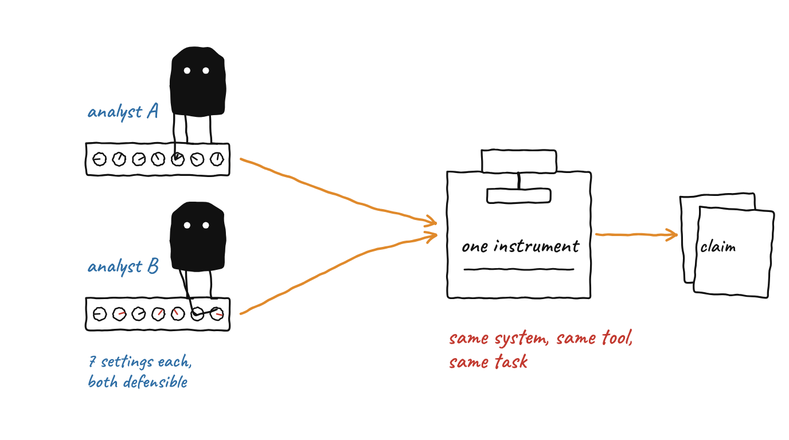
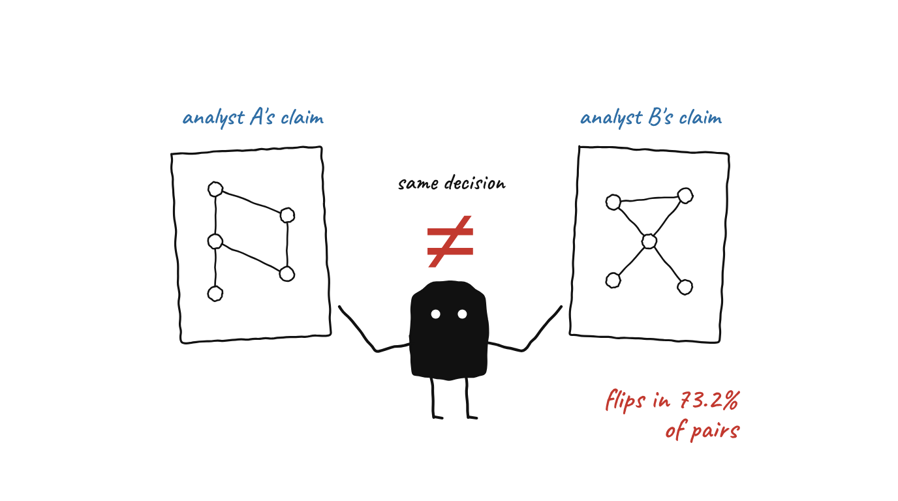
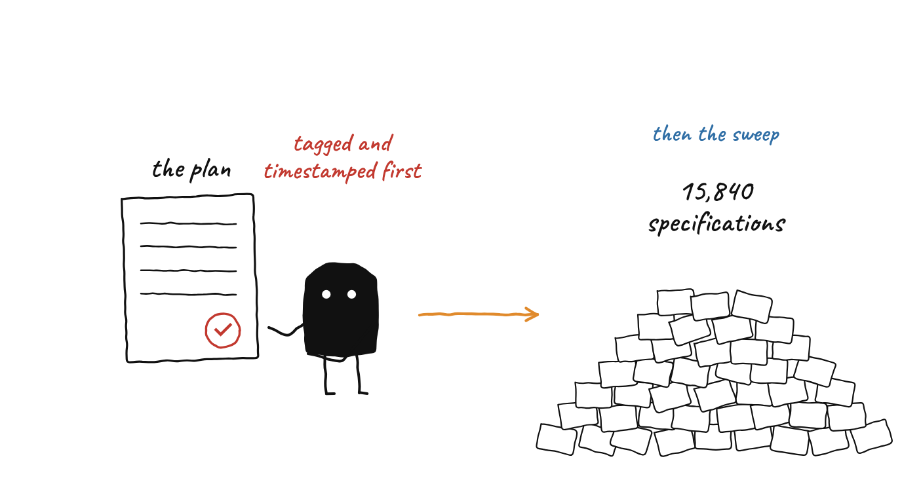
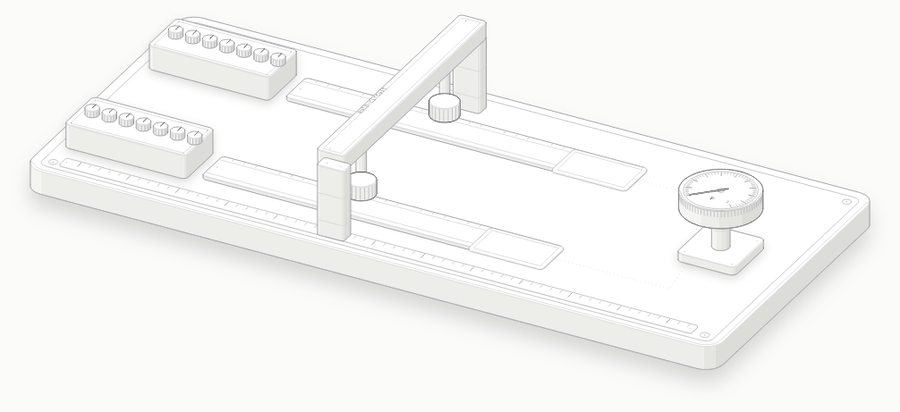

# Explanation Multiplicity

**Circuit-level interpretability evidence does not survive defensible analytic variation.**

[](https://arxiv.org/abs/2608.13754)
[](LICENSE)
[](tests/)
[](preregistration/)

An audit means two auditors reach the same conclusion. That is not a definition
borrowed from machine learning; it is what makes an audit worth commissioning.

The EU AI Act requires providers of high-risk AI systems to file technical
documentation describing how the system reaches its decisions. Mechanistic
interpretability is the obvious source of that evidence, and circuit discovery is
its most developed instrument. This repository measures whether that evidence
survives the condition under which it would be relied upon: **two competent
analysts, the same system, the same tool, different defensible settings.**

## The idea in one look

<p align="center">
  <br>
  <sub><b>Same system, same tool, same task.</b> Two analysts make different but defensible choices on seven settings. The instrument is the same.</sub>
</p>

<p align="center">
  <br>
  <sub><b>The claims differ.</b> The filed claim flips in 73.2% of specification pairs (F = 0.7316).</sub>
</p>

<p align="center">
  <br>
  <sub><b>Plan first, then look.</b> The analysis plan was committed and tagged before the 15,840-specification sweep it governs.</sub>
</p>

### The whole study as one bench

<p align="center">
  
</p>

| On the bench | In the study | Where to look |
|---|---|---|
| Two panels of seven knobs | Two analysts, each fixing the seven axes of a specification (discovery objective, ablation, corruption, prompt variant, seed, metric, threshold `tau`) | [`src/p1/spec.py`](src/p1/spec.py), [`configs/sweep.yaml`](configs/sweep.yaml) |
| One gantry press over both belts | The same instrument, auto-circuit 1.0.1, unmodified | [The instrument](#the-instrument) |
| A stamped slip | The claim, derived by the deterministic claim map `phi`, never by a language model | [`src/p1/claim_map.py`](src/p1/claim_map.py) |
| Two slips side by side | A pair of specifications whose claims are compared | [`src/p1/multiverse.py`](src/p1/multiverse.py) |
| The dial gauge | The claim flip rate `F` over pairs | [`analysis/verify_all_claims.py`](analysis/verify_all_claims.py) |

Open [`docs/anatomy/multiplicity-bench-light.html`](docs/anatomy/multiplicity-bench-light.html) in a browser to scrub through it (details in [`docs/anatomy/README.md`](docs/anatomy/README.md)). The knob positions and claim slips are drawn for the picture; only `F`, the counts and the seven axes come from the study.

### Step by step

| Step | What happens | Why it matters |
|---|---|---|
| **1. Fix a specification** | One choice on each of seven axes. The confirmatory grid holds 15,840 of them, enumerated without a GPU. | A competent analyst has to make these choices before a circuit exists. None is obviously wrong. |
| **2. Discover a circuit** | auto-circuit searches GPT-2 small on the indirect object identification task. | The instrument is fixed; only the specification changes. |
| **3. Derive the claim** | The claim map `phi` turns the circuit into a structured statement, at three nested granularities. | The claim is what an auditor would file, so it is what must be stable. |
| **4. Compare pairs** | Claims, circuit overlap (`J_bar`) and functional agreement (kappa) are compared across specification pairs. | This is where `F = 0.7316` comes from. |
| **5. Check against a null** | A random-circuit null multiverse supplies joint inference. No p-value is computed across specifications. | The specifications are a designed grid, not a sample. |
| **6. Verify** | `verify_all_claims.py` recomputes every headline number from raw results. | Every number traces to a config, a seed and an environment fingerprint. |

## Headline results

Across **15,840 pre-registered specifications** on GPT-2 small and the indirect
object identification task, of which 7,561 produced a claim:

| quantity | value | 95% CI |
|---|---|---|
| Claim flip rate `F` | **0.7316** | 0.7247 to 0.7380 |
| Modal claim share `pi*` | 0.4109 | |
| `F` after standardising the evaluation metric | 0.5939 | 0.5803 to 0.6063 |
| `F` with circuit size removed from the claim and held fixed | 0.2706 | 0.2550 to 0.2859 |
| Mean pairwise circuit overlap `J_bar` | 0.1396 | 0.1377 to 0.1418 |
| Functional agreement, Cohen's kappa | 0.0146 | |

The filed claim flips across 73.2% of specification pairs. The circuits behind
those claims are structurally near-disjoint and functionally uncorrelated, so the
instability is **not** one mechanism described in different words.

Every number above is recomputed from raw results by
[`analysis/verify_all_claims.py`](analysis/verify_all_claims.py), 39 checks,
0 failures, with `F` derived by three independent routes including brute-force
enumeration over all 28,580,580 specification pairs.

## Pre-registration

Two plans, each committed and tagged **before** the results they govern existed.

| tag | plan | status |
|---|---|---|
| `prereg-p1-confirmatory` | [`preregistration/PLAN.md`](preregistration/PLAN.md) | complete, reported in the paper |
| `prereg-p1-replication` | [`preregistration/PLAN-REPLICATION.md`](preregistration/PLAN-REPLICATION.md) | **not yet run**, see v2 below |

```bash
git log -1 --format=%ci prereg-p1-confirmatory   # predates the confirmatory sweep
git log -1 --format=%ci prereg-p1-replication    # predates any replication cell
```

Every departure from a locked plan is recorded in
[`preregistration/DEVIATIONS.md`](preregistration/DEVIATIONS.md), including the
ones that were mistakes.

## Reproducing

**The statistics layer needs no GPU.** This is deliberate: the mathematics must be
verifiable without the circuit pipeline.

```bash
pip install -r requirements-analysis.txt
python3 -m pytest tests/ -q                 # 367 passed, 1 skipped
python3 analysis/verify_all_claims.py       # 39 checks against raw results
python3 analysis/emit_tables.py             # every paper table, from stored results
python3 analysis/figure1.py --out paper/figures
```

All 1,540 per-cell manifests and the analysis outputs are committed, so the
headline numbers are reproducible from this repository alone. Raw circuits are
too large to track and are regenerated by the sweep.

**The full sweep needs a GPU** (about 20 h on an L4 for the confirmatory grid):

```bash
pip install -r requirements.txt
python3 scripts/sweep.py --config configs/sweep.yaml --dry-run
python3 scripts/sweep.py --config configs/sweep.yaml --out results/sweep
```

Resume is per cell: a dropped session costs the cell in flight and nothing more.

## Layout

```
configs/          one file per experimental specification, no hardcoded params
src/p1/           library code, importable, tested, no torch in the stats layer
scripts/          entry points taking a config and writing to results/
analysis/         reads results/, produces figures, tables and verification
preregistration/  analysis plans, calibration, and every deviation
results/          per-cell manifests and analysis outputs
paper/            manuscript and arXiv source
docs/             findings, citation ledger, design deltas, research memory,
                  anatomy/ (interactive figure) and illustrations/ (README images)
tests/            pytest, 367 passed and 1 skipped
RESEARCH_LOG.md   dated, append-only: what was run and what was learned
```

## The instrument

[`auto-circuit`](https://github.com/UFO-101/auto-circuit) 1.0.1, the library
released with the closest prior work (arXiv:2407.08734, CoLM 2024).

**Reproduced verbatim and never modified.** Every extension lives in `src/p1/`,
is additive only, and is reported as an extension. Modifying the instrument under
test would hand a reviewer a free rejection.

One finding about the instrument is reported in the paper: **one of seven
documented, publicly exported discovery objectives does not execute at all** on
the library's own canonical task, discarding 220 of 1,540 cells.

## What this repository is not claiming

Stated early because each is a reading the results do not support.

- **Not** that discovered circuits are no better than random. With size held
  fixed the ordering reverses and they are more stable than a size-matched null,
  0.2746 against 0.4230.
- **Not** that filings differ where mechanisms do not. Mechanisms differ a great
  deal.
- **Not** that random seeds are the problem. The seed selects which prompts are
  sampled, so this is evaluation-set variability, not nondeterminism.
- **Nothing at all about scale.** One model, one task.

## v2: the second-model replication

Pre-registered and tagged, harness verified, **not yet run**. Blocked on GPU
access only.

- **Model** Pythia-160m, a different architecture family. GPT-NeoX runs attention
  and MLP in parallel, so its factorised graph has 32,347 edges against GPT-2
  small's 32,491, a deficit of exactly `n_blocks * n_heads`. Predicted from the
  closed-form ordering, then matched against the instrument.
- **Grid** 924 cells, 11,088 specifications. Identical to the confirmatory grid on
  every axis except that `seed` carries three levels rather than five.
- **Gate P, passed before the plan was written.** Pythia-160m performs the task:
  IO preferred on 96.1% of clean prompts, mean logit difference 117% of GPT-2
  small's on the same prompts.
- **Criteria fixed in advance.** What counts as replication rather than
  refutation, and the three conditions that would make the comparison
  uninterpretable, are in
  [`PLAN-REPLICATION.md`](preregistration/PLAN-REPLICATION.md) section 5.
- **Both abstracts are already drafted**, section 7. If only one direction were
  writeable, the design would be wrong.

The comparison between models is descriptive and carries **no p-value**. The two
grids share the claim map, the task, the templates and six of seven axes, so they
are not independent samples of anything.

Running instructions are in [`docs/NEXT-SESSION.md`](docs/NEXT-SESSION.md).

## Citation

```bibtex
@misc{mahale2026explanation,
  title         = {Explanation Multiplicity: Circuit-Level Interpretability
                   Evidence Does Not Survive Defensible Analytic Variation},
  author        = {Mahale, Ajay Pravin},
  year          = {2026},
  eprint        = {2608.13754},
  archivePrefix = {arXiv},
  primaryClass  = {cs.AI},
  url           = {https://arxiv.org/abs/2608.13754}
}
```

## Licence

Code and data in this repository: [MIT](LICENSE).
The manuscript on arXiv is licensed CC BY 4.0.
